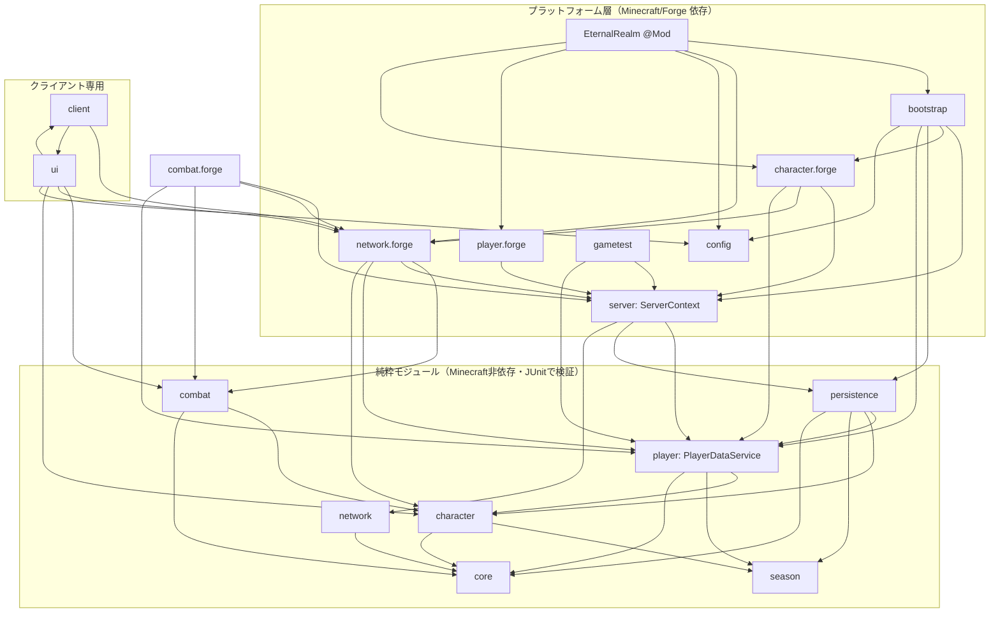

# ETERNAL REALM アーキテクチャ

最終更新: 2026-11-08（Phase 2 時点）

## 1. 設計原則

| # | 原則 | 具体策 |
|---|------|--------|
| 1 | サーバー権威 | クライアントは「操作意図」だけを送る。数値（EXP・ステータス・ダメージ等）は常にサーバーが計算し、スナップショットで返す |
| 2 | ゲームルールをMinecraftから分離 | ルール・永続化・プロトコル判定は「純粋モジュール」に置き、Minecraft/Forgeなしでテストする（ポート＆アダプタ） |
| 3 | UUID基準 | プレイヤー識別は常にUUID。名前は表示用の記録のみ |
| 4 | 永続化をメインスレッドから分離 | ブロッキングI/Oはプレイヤー単位で順序保証された専用スレッドで実行。メインスレッドは不変レコードを渡すだけ |
| 5 | 論理サーバー単位のライフサイクル | 状態はすべて `ServerContext` に集約し、サーバー起動時に生成・停止時に破棄（シングルプレイでワールドを開き直しても状態が漏れない） |
| 6 | 失敗時は「進めない」 | 読み込み失敗時に新規データを作らない／壊れたデータは隔離して前世代から復旧／保存失敗はメモリに保持して再試行 |
| 7 | 段階的拡張 | まず単一サーバーで完成させ、リポジトリ（ポート）差し替えでPostgreSQL・複数サーバーへ拡張 |

## 2. ディレクトリ構成

```
minecraftproject/
├── build.gradle, settings.gradle, gradle.properties, gradlew   … 公式Forge 1.20.1 MDK準拠
├── .github/workflows/build.yml        … CI: ビルド＋ユニットテスト＋GameTestサーバー起動
├── docs/                               … 設計書（本書ほか）
├── tools/offline-test.sh               … Forge不要の純Javaテスト（ネットワーク制限環境用）
└── src/
    ├── main/java/com/eternalrealm/
    │   ├── EternalRealm.java           … @Mod エントリ。配線のみ
    │   ├── core/          [純粋] ModInfo, PeriodicTrigger, IncidentIds
    │   │   ├── concurrent/            KeyedSerialExecutor（プレイヤー単位直列I/O）, MainThreadQueue
    │   │   └── data/                  DataAccessException / Corrupt / Incompatible
    │   ├── season/        [純粋] SeasonId（シーズン管理本体は Phase 10）
    │   ├── character/     [純粋] StatType, StatBlock, CharacterRules, ExperienceCurve,
    │   │   │                         PlayerCharacter, CharacterRecord, CharacterSnapshot,
    │   │   │                         CharacterRepository（ポート）
    │   │   └── forge/     [Forge]  コマンド、同期送信、レベルアップ演出、暫定EXP源
    │   ├── player/        [純粋] PlayerSession, SessionState, AccountRecord,
    │   │   │                         AccountRepository（ポート）, PlayerDataService
    │   │   └── forge/     [Forge]  ログイン／ログアウト連携
    │   ├── persistence/   [純粋] file/（JSON・原子的書き込み・隔離）, backup/（zipスナップショット）
    │   ├── combat/        [純粋] WeaponProfiles, Combatant（行動の状態マシン）, CombatStats, DamageCalculator,
    │   │   │                         HitGeometry, CombatService
    │   │   └── forge/     [Forge]  武器アイテム, CombatDriver（tick・要求・防御）, CombatHits, CombatEvents, StatEffects
    │   ├── network/       [純粋] TokenBucketRateLimiter, ViolationTracker
    │   │   └── forge/     [Forge]  SimpleChannel, パケット, ServerPacketGuard, ClientboundHandlers
    │   ├── server/        [Forge] ServerContext, SyncQueue
    │   ├── bootstrap/     [Forge] ServerBootstrap（コンポジションルート・tick・停止処理）
    │   ├── config/        [Forge] ERServerConfig / ERClientConfig
    │   ├── testkit/       [Forge] テスト用コマンド /er admin test（最大化・見学用の屋敷、modules/testkit.md）
    │   ├── client/        [クライアント専用] 表示用状態、キー割り当て、クライアントイベント
    │   ├── ui/            [クライアント専用] hud/（HUD）, screen/（キャラクター画面）
    │   └── gametest/      [Forge・開発時のみ有効] サーバー内統合テスト
    ├── main/resources/    META-INF/mods.toml, assets/eternalrealm/lang/{en_us,ja_jp}.json,
    │                      data/eternalrealm/structures/empty.nbt（GameTest用）
    └── test/java/         JUnit（純粋モジュール, PlayerDataService統合, ArchitectureTest）
```

### 仕様書のモジュール一覧との対応

| 仕様のモジュール | パッケージ | フェーズ | 状態 |
|---|---|---|---|
| core | `core` | 0〜1 | 実装済 |
| network | `network`, `network.forge` | 1〜2 | 実装済（基盤＋6パケット、プロトコル2） |
| player | `player`, `player.forge` | 1 | 実装済（UUIDセッション・アカウント） |
| character | `character`, `character.forge` | 1 | 実装済（レベル・EXP・ステータス） |
| persistence | `persistence` | 1 | ファイル実装済／PostgreSQLは Phase 1.5 |
| ui / client | `ui`, `client` | 1〜2 | 基本HUD・キャラクター画面・戦闘HUD・ダメージ数値・戦闘入力（予測） |
| combat | `combat`, `combat.forge` | 2 | 実装済（4武器・コンボ・溜め・回避・ガード/パリィ・武器スキル・ステータス反映）。職業スキルは Phase 3 |
| class | **`job`**（`class` はJavaの予約語） | 3 | 未着手 |
| item, equipment | `item`, `equipment` | 3 | 未着手 |
| mob, boss, dungeon | `mob`, `boss`, `dungeon` | 4 | 未着手 |
| world, quest | `world`, `quest` | 5 | 未着手 |
| ranking | `ranking` | 6 | 未着手（設計: RANKING_SYSTEM.md） |
| party, raid, guild, economy, crafting | 同名 | 7 | 未着手 |
| season | `season` | 10（IDのみPhase 1から） | 未着手（設計: SEASON_SYSTEM.md） |
| backend | `backend`（認証・複数サーバー連携） | 将来 | 未着手 |

## 3. レイヤーと依存ルール



| ルール | 内容 | 検査 |
|---|---|---|
| R1 | 純粋モジュール（`core`, `season`, `character`, `player`, `persistence`, `network`, `combat`。各 `forge` サブパッケージを除く）は `net.minecraft` / `net.minecraftforge` / `com.mojang` / `org.lwjgl` / `io.netty` とプラットフォーム層を参照しない | `ArchitectureTest`（コメントは除外して実コードのみ検査） |
| R2 | `client` / `ui` 以外はクライアント専用クラス（`net.minecraft.client` 等）と `client` / `ui` パッケージを参照しない ＝ 専用サーバーでクライアントクラスが読み込まれない | `ArchitectureTest` ＋ CIのGameTestサーバー起動 |
| R3 | ドメインがポート（`CharacterRepository`, `AccountRepository`）を定義し、`persistence` が実装する（依存は外→内） | 構造 |
| R4 | サーバー→クライアント処理は `ClientboundHandlers` の差し込み口経由。共通コードはクライアントコードを直接呼ばない | R2で担保 |
| R5 | 状態の所有者は1つ。キャラクターの可変状態は `PlayerDataService` だけが持ち、外部へはスナップショット（不変）で渡す | 構造 |

## 4. 実行時構成

### 4.1 ServerContext（論理サーバーごと）

`ServerAboutToStartEvent` で生成（サーバー設定はこの直前にForgeが読み込む）、`ServerStoppedEvent` で破棄。専用サーバー・シングルプレイ（内蔵サーバー）・GameTestサーバーで同一。

| 構成要素 | 役割 |
|---|---|
| `PlayerDataService` | セッション、キャラクター、オートセーブ、停止時フラッシュ |
| `KeyedSerialExecutor<UUID>` | プレイヤー単位で直列化されたI/Oスレッドプール |
| `MainThreadQueue` | I/O完了通知をサーバースレッドへ戻すキュー（tickごとに処理） |
| `SnapshotBackupService` + `PeriodicTrigger` | 定期・手動・停止時のzipスナップショット |
| `TokenBucketRateLimiter`, `ViolationTracker` | パケットのレート制限と違反カウント |
| `SyncQueue` | このtickで変化したプレイヤーをまとめ、tick終了時に1回だけ同期送信 |
| `CombatDriver` | 戦闘: 要求の判定、ヒットフレームの実行、防御フック、戦闘値の適用と送信（専用の `SyncQueue` とレート制限を持つ） |

tick終了時の処理順: `MainThreadQueue` → `PlayerDataService.tick` → キャラクター同期 → `CombatDriver.tick`（戦闘値の更新 → 装備・ガード状態の同期 →
状態マシン → 命中処理 → 状態送信）→ バックアップ判定。戦闘のクライアント予測は同じ `Combatant` をクライアントtickで動かす（COMBAT_SYSTEM.md 3章）。

### 4.2 スレッド

| スレッド | 触れてよいもの |
|---|---|
| サーバースレッド | `ServerContext` のすべて（`PlayerDataService` の状態はここに閉じる） |
| EternalRealm-IO-n | リポジトリ（ファイル）と不変レコードのみ。結果は `MainThreadQueue` へ |
| EternalRealm-Backup | データディレクトリの読み取りとzip作成のみ |
| Netty（受信） | パケットのデコードとサイズ検査のみ。処理は `consumerMainThread` でサーバースレッドへ |
| クライアントスレッド | `ClientCharacterState`、HUD、画面 |

> `MinecraftServer#execute` を使わない理由: サーバー停止中（`stopped=true`）は投入したタスクが**呼び出し元スレッドで即実行**される。I/Oスレッドから呼ぶと停止処理と並行して状態を書き換えてしまうため、自前の `MainThreadQueue` を使う。

### 4.3 主要フロー

**ログイン**
1. `PlayerLoggedInEvent` → `PlayerDataService.onPlayerJoin(uuid, name)` → セッション `LOADING`（世代番号つき）
2. I/Oスレッド: アカウント読込・ログイン回数更新・保存 → キャラクター読込
3. サーバースレッド: 世代が一致する場合のみ適用。メモリ上に未保存データがあればそれを優先。無ければ新規作成。→ `ACTIVE` → 同期送信
4. 読込失敗: `FAILED` → 障害IDつきで切断（新規データは作らない）

**ゲーム操作（例: ステータス割り振り）**
クライアント `AllocateStatPacket(stat, amount)` → `ServerPacketGuard`（送信者・レート・ACTIVE確認）→ `PlayerDataService.allocateStat`（ルール検証）→ 変更をマーク → tick終了時に `CharacterSnapshotPacket` を送信 → クライアントは受け取った値を表示するだけ

**ログアウト** → セッション除去 → 変更があれば不変レコードを保存キューへ（同じUUIDの次のログイン読込は必ずこの保存の後に実行される）

**オートセーブ** → 一定間隔で変更のあるキャラクターだけを保存。保存中のものは重複投入しない

**停止** → `ServerStoppingEvent` で変更のある全キャラクターの保存を先に投入（vanillaのワールド保存と並行）→ vanillaが接続を閉じる
（このときリモートプレイヤーの `PlayerLoggedOutEvent` は確実には発火しないため、ログアウト保存には頼らない）→ `ServerStoppedEvent` でまだ読み込まれている全データを投入し、
I/Oの完了を最大N秒待つ → プレイヤーごとに最新の保存を確認（失敗は同期的に1回再試行、だめなら `emergency/` へ退避）→ 結果をレポート → 停止時スナップショット → スレッド停止。
コンテキストの破棄は「そのサーバーのものか」を確認してから行う（古いサーバーの停止イベントが新しいサーバーの状態を壊さない）。

## 5. 拡張方針

| 予定 | 方針 |
|---|---|
| 2種目以降のプレイヤーデータ（インベントリ・クエスト等） | `PlayerDataService` に「プレイヤーデータ参加者」インターフェースを導入し、各モジュールがロード/セーブを登録。セッションは全参加者のロード完了で `ACTIVE`（Phase 3で導入予定） |
| PostgreSQL | `CharacterRepository` / `AccountRepository` のJDBC実装を追加。ドメイン・サービスは変更不要（Phase 1.5） |
| 複数サーバー | DB上のセッションリース（UUIDごとの排他）を追加し、同一キャラクターが2サーバーで同時にロードされないようにする |
| 戦闘など高頻度パケット | 意図パケット＋サーバー側判定（COMBAT_SYSTEM.md）。`ServerPacketGuard` を共通入口として再利用 |
